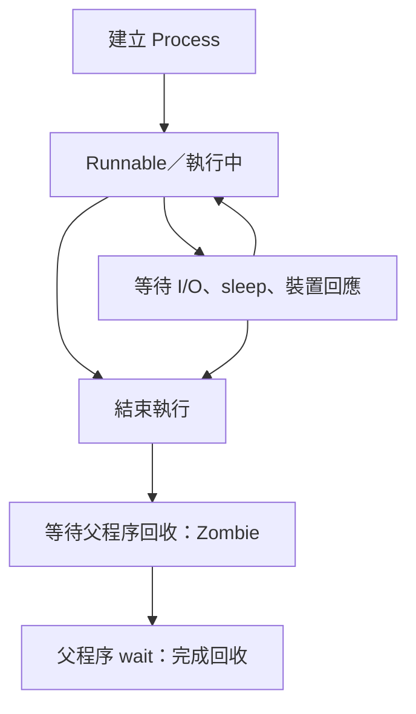

# Process：生命週期、Signal 與安全清理

日期：2026-10-20  
適用範圍：Linux／macOS，以及 Android 測試與 Headless Emulator 的概念對照。

## 1. Process 是什麼？

Process（程序）是 OS 管理的一個執行實體，有自己的 PID、記憶體空間與檔案描述符等資源。程式檔案是靜態內容；啟動後才會有 Process。同一個程式可以同時啟動多個 Process。

在 Device Test Runner（DTR）裡：

- DTR 本身是一個 Process。
- `subprocess.Popen()` 啟動的測試腳本是子程序。
- 測試腳本再啟動的 recorder、adb 等命令，可能形成更深的程序樹。

Process 還活著，不代表一直占用 CPU：它可能在等待裝置、網路、磁碟，或執行 `sleep()`。

## 2. 生命週期與執行狀態

簡化的生命週期如下。這是教學模型，並非完整的 kernel 狀態圖；不是每一次結束都會留下可觀察到的 Zombie。



Linux `ps` 常見狀態：

| 狀態 | 意義 | 例子 |
| --- | --- | --- |
| `R` | Running／Runnable，正在執行或等待 CPU | 計算、解析檔案 |
| `S` | 可中斷的等待 | sleep、等待事件 |
| `D` | 不可中斷的等待，常與 kernel I/O 有關 | 某些儲存裝置 I/O |
| `T` | 停止執行 | 被 SIGSTOP 暫停、工作控制 |
| `Z` | Zombie，已結束但退出資訊尚未被回收 | 父程序尚未 wait |

macOS 的狀態表示與 Linux 不完全相同，請以該平台的 `ps` 說明為準。

**Signal 是影響 Process 的事件，不是生命週期階段。**

## 3. Process 怎麼結束？

### 3.1 正常完成

程式執行到最後，或主動呼叫退出函式：

```python
import sys

sys.exit(0)
```

慣例上，exit code `0` 代表成功，非 `0` 代表錯誤或其他非成功結果；具體意義由程式定義。

### 3.2 由外部送出 Signal

```bash
kill -TERM 12345
```

`kill` 的核心功能是「送訊號」。訊號可能要求終止、暫停或繼續執行，不一定立即殺掉程序。

訊號能否送出也受權限限制。

## 4. SIGTERM、TERM、SIGKILL 的差別

| Signal | 簡寫 | Linux／macOS 常見編號 | 預設效果 | 能否捕捉或忽略 |
| --- | --- | --- | --- | --- |
| `SIGINT` | `INT` | 2 | 終止；Python 通常轉成 KeyboardInterrupt | 可以 |
| `SIGTERM` | `TERM` | 15 | 終止 | 可以 |
| `SIGKILL` | `KILL` | 9 | 強制終止 | 不可以 |
| `SIGSTOP` | `STOP` | 平台有差異 | 暫停執行 | 不可以 |
| `SIGCONT` | `CONT` | 平台有差異 | 繼續執行 | 可註冊 handler；繼續效果仍會發生 |

優先使用訊號名稱；不是所有編號都跨平台一致。

以下在 Linux／macOS 都是送出 SIGTERM：

```bash
kill -TERM 12345
kill -SIGTERM 12345
kill -15 12345
kill 12345
```

`TERM` 是 `SIGTERM` 的簡寫，不是另一種訊號。

### SIGINT：中斷請求

終端機按 Ctrl+C 通常會對前景程序群組送出 SIGINT。Python 預設通常將它轉成 `KeyboardInterrupt`。

### SIGTERM：給程式自行退出的機會

程序可以註冊 handler，收到訊號後停止接新工作、保存進度、關閉 recorder，再退出。

**送 SIGTERM 不代表清理一定會發生。** 沒有自訂 handler 時，預設行為通常是直接終止；也不能假設 Python 的 `finally` 一定會因此執行。程序也可能忽略訊號或卡住。

### SIGKILL：由 OS 強制終止

程序無法捕捉、阻擋或忽略 SIGKILL。程式的 handler、`finally` 與 `atexit` 沒有執行機會。

OS 會回收程序的記憶體、關閉檔案描述符等，但不會替應用程式補完 report、刷新使用者空間 buffer、停止外部儀器或還原手機狀態。

強制終止也不保證立刻消失。例如 Linux 程序卡在某些不可中斷等待時，可能要等該等待返回，才能完成終止。

## 5. 安全停止：TERM → 等待 → KILL → 回收

DTR 的典型策略：

1. 送出 SIGTERM，要求程序結束。
2. 等待 grace period，留時間清理。
3. 超時仍未結束才送出 SIGKILL。
4. 呼叫 `wait()` 收取退出狀態並回收子程序。

以下是 Linux／macOS、只管理單一直接子程序的最小範例：

```python
import subprocess
import sys

process = subprocess.Popen(
    [sys.executable, "test_script.py"],
)

try:
    return_code = process.wait(timeout=60)
except subprocess.TimeoutExpired:
    process.terminate()  # POSIX：SIGTERM
    try:
        return_code = process.wait(timeout=5)
    except subprocess.TimeoutExpired:
        process.kill()  # POSIX：SIGKILL
        return_code = process.wait()
```

這個範例沒有使用 PIPE。若 stdout／stderr 設成 PIPE，必須持續讀取，或適當使用 `communicate()`；否則 pipe buffer 填滿可能導致阻塞。DTR 的串流 reader threads 就是在處理這一類需求。

最後的 `wait()` 沒有 timeout，是為了確實回收直接子程序；它不是保證整個清理流程一定在固定秒數內完成。需要嚴格總期限的系統，還要另外設計監督與後續回收機制。

Windows 的 `terminate()`／`kill()` 語意不同，不能直接套用這份 POSIX 訊號說明。

## 6. poll、wait、terminate、kill 各做什麼？

| Python API | 功能 | 是否等待結束 |
| --- | --- | --- |
| `Popen(...)` | 啟動程序並返回控制物件 | 不等待程序完成 |
| `process.poll()` | 檢查是否結束；仍執行回傳 None，已結束回傳 return code | 不阻塞等待；可回收已退出的直接子程序 |
| `process.wait(timeout=...)` | 等待退出並取得 return code | 是；可設 timeout |
| `process.terminate()` | POSIX 上對直接子程序送 SIGTERM | 否 |
| `process.kill()` | POSIX 上對直接子程序送 SIGKILL | 否 |
| `process.communicate()` | 處理 stdin／stdout／stderr，並等待退出 | 是；可設 timeout |

在 POSIX Python `subprocess` 中，若子程序因訊號 N 結束，return code 通常為 `-N`，例如 `-15`、`-9`。Shell 常見的 `143`、`137` 是另一種慣例（128 + 訊號編號），不要與 Python 的回傳值混淆。

## 7. Zombie、Orphan 與程序樹

### Zombie：已經死了，但退出資訊還沒被收走

子程序結束後，OS 可能保留 PID 與退出狀態，供父程序讀取。父程序透過 `wait()`／`waitpid()` 等機制回收。

Zombie 已沒有程式碼在執行，送 SIGKILL 無法再殺一次。Python 的 `wait()`、`communicate()`，或確認退出的 `poll()`，能完成相應回收。

### Orphan：父程序先結束，子程序仍存活

Orphan（孤兒程序）與 Zombie 不同。父程序結束不保證子程序一起結束；仍存活的子程序會依系統規則被重新收養。

例如 DTR 啟動 shell，shell 再啟動 recorder：只終止 shell，recorder 可能繼續錄製。

### Process group：管理一組相關程序

POSIX 可以透過 `start_new_session=True`，讓新程序成為新 session 與 process group 的領導者，再用 `os.killpg()` 對群組送訊號。

```python
import os
import signal
import subprocess
import sys

process = subprocess.Popen(
    [sys.executable, "test_script.py"],
    start_new_session=True,
)

# 停止這次工作時，對所建立的群組發訊號。
try:
    os.killpg(process.pid, signal.SIGTERM)
except ProcessLookupError:
    pass  # 送訊號前，群組可能已退出。
```

這只是群組發訊號示意，不是完整 cleanup 實作：

- 必須確認操作的是自己建立並追蹤的群組。
- 直接子程序退出，不代表群組內其他程序都退出。
- 完整流程仍需等待、必要時對群組送 SIGKILL，並回收直接子程序。
- 子程序若自行建立新 session／group，可能離開原群組。
- 不要直接把「殺 process group」當成「必定清掉所有後代程序」。

## 8. Android：Package force-stop 與 kill process

Package 是已安裝 App 的身分；Process 是執行時的 OS 實體。兩者不是一對一：一個 App 可以有多個 Process。

| 操作 | 層級與對象 | 主要效果 |
| --- | --- | --- |
| `adb shell am force-stop PACKAGE` | Android Framework，指定 Package／使用者 | 停止相關執行與元件，設定 Package stopped state |
| `adb shell am kill PACKAGE` | Android Activity Manager，指定 Package | 殺掉系統判斷可安全終止的背景程序 |
| `adb shell kill -TERM PID` | OS 訊號，指定 PID | 送 SIGTERM；需要權限 |
| `adb shell kill -KILL PID` | OS 訊號，指定 PID | 強制終止；需要權限 |

只殺 Process，Android 仍可能依元件需求重建它。Force-stop 還會設定 Package stopped state，限制 App 自行恢復執行，直到使用者直接或間接互動等允許的情況。

Android 15 另會取消進入 stopped state App 的 PendingIntent；細節依 Android 版本而異。

這些操作都不等於 `pm clear`，不會因此清除 App 的持久資料。Package stopped state 也不是 Activity 的 `onStop()` 狀態。

差異在操作層級與語意，不在「有沒有 API」：低階 kill 也可以有 API。Force-stop 也不是一般 App 都能任意呼叫的公開 SDK 能力，受到系統權限限制。

## 9. Android Environment：Headless Emulator stop

AVD 是模擬裝置的設定與資料；Emulator 是執行模擬裝置的程式；Android Framework 則在模擬裝置內執行。

```bash
adb -s emulator-5554 emu kill
```

這是透過 Emulator console 要求模擬器結束，不是 `am force-stop`，也不應直接等同 Android guest OS 的完整正常關機流程。

建議的停止策略：

| 階段 | 操作 | 確認重點 |
| --- | --- | --- |
| 1 | Emulator 控制介面要求退出 | 指令有沒有成功送達 |
| 2 | 等待並檢查程序退出 | ADB 消失不一定代表 host 程序已退出 |
| 3 | 對追蹤的殘留程序／群組送 SIGTERM | 留清理機會 |
| 4 | 超時後送 SIGKILL | 處理卡住的程序 |
| 5 | 回收子程序、整理自有狀態 | wait、reader threads、PID 記錄等 |

以上是設計說明，不是對現有 `headless stop` 原始碼的驗證。實作時要確認 PID 屬於這次啟動的 Emulator，避免只按程序名稱廣泛終止其他模擬器。

## 10. DTR：程序停止與測試 teardown 是兩件事

停止程序處理的是 OS 資源；teardown 處理的是測試環境與實驗資源，例如停止 recorder、還原裝置設定、保存部分報告。

終止 Process 不會自動完成這些業務清理。穩健的 runner 需要同時管理：

- 取消／timeout 的分類與是否允許 retry。
- 前一次 attempt 的程序清理，避免與下一次重疊。
- 有獨立 timeout 的 teardown。
- 部分 stdout／stderr、artifact 與 report 的保存。

**記憶重點：Signal 用來要求停止，wait 用來確認與回收；process group 用來擴大管理範圍，teardown 用來還原實驗環境。**

## 參考文件

- [Python subprocess](https://docs.python.org/3/library/subprocess.html)
- [Python signal](https://docs.python.org/3/library/signal.html)
- [Python os.killpg](https://docs.python.org/3/library/os.html#os.killpg)
- [Linux signal(7)](https://man7.org/linux/man-pages/man7/signal.7.html)
- [Linux wait(2)](https://man7.org/linux/man-pages/man2/wait.2.html)
- [Android ADB：Activity Manager](https://developer.android.com/tools/adb#am)
- [Android Emulator console](https://developer.android.com/studio/run/emulator-console)
- [Android 15：Package stopped state](https://developer.android.com/about/versions/15/behavior-changes-all#enhanced-stop-states)
